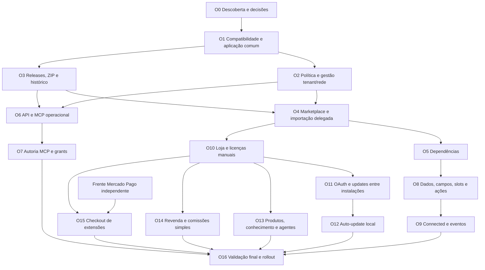

# Plano executável — evolução de Extensões do DeskcommCRM

Data: 26/10/2026. Estado: **planejado, não executado**. Destinatário: Luna ou outro implementador, com revisão humana de arquitetura e entregas pequenas. Ler os documentos [produto](../specs/2026-10-26-extensoes-plataforma-design.md), [contratos/banco](../specs/2026-10-26-extensoes-contratos-dados.md), [testes](../specs/2026-10-26-extensoes-matriz-testes.md) e [Mercado Pago](../specs/2026-10-26-mercado-pago-adaptador-design.md) antes de implementar.

## 1. Mandato e limites

Este plano descreve a capacidade completa desejada, não ordena implementá-la inteira num único commit. Preferências de produto aprovadas pelo usuário do fork não equivalem a aceitação upstream de conflitos com ADRs vigentes. Portão O0 registra decisões e diferenças; depois executar ondas com independência explícita. Não marcar uma onda como pronta por ter criado pastas, interfaces vazias ou mockups. Contrato, consumidor real, teste, UI e distribuição devem fechar juntos.

Ambiente: checkout compartilhado WSL `/home/junio/projects/deskcommcrm-dev`, branch observada `master`, HEAD de referência `f702a018e`. A árvore tem trabalho concorrente Telegram/MCP; não fazer reset, stash global, checkout, nova branch/worktree, merge ou push por conta própria. Revalidar ambiente/branch antes da execução porque o estado pode mudar. Mac é controlador/leitor, não segundo stack de dev. Não copiar segredos nem dados de produção para testes. Publicação upstream e deploy não estão autorizados por esta spec.

Não editar código apenas para acomodar uma suposição desta proposta que contrarie doutrina: produzir revisão explícita, com razão, alternativa e teste. Nenhum placeholder de número/timestamp vira migration sem conferir a base. `MANIFEST.md` é histórico; cada nova migration tem `-- manifest:` + apêndice idempotente no baseline, regeneração de tipos e prova de upgrade com dados.

## 2. Sequência e dependências

O primeiro lançamento técnico pode fechar O0–O6 e a fatia mínima de O8 com seus consumidores. Autoria pode vir na sequência. Loja manual pode lançar antes do adapter Mercado Pago e do checkout. `hosted`/Wasm, hooks quentes amplos, versões simultâneas por tenant, split e atestado remoto forte ficam fora dessas ondas, com ADRs futuras próprias. Todas as intenções da conversa aparecem em produto; postergar uma frente significa registrar a dependência e manter a API preparada, não prometer que já existe.

## 3. Pacote de evidência por onda

Cada onda termina com: (a) problema e comportamento entregues; (b) arquivos alterados; (c) contratos e migrations efetivos; (d) consumidor real; (e) IDs da matriz de testes e comandos/RC; (f) prova visual em ambiente fresco quando aplicável; (g) evidências de upgrade; (h) falhas conhecidas e não medido; (i) checklist Sistema Vivo com nomes concretos; (j) fragmento `.changes/` quando comportamento muda; (k) próximos passos. Guardar evidência em `docs/evidence/extensoes/<onda>/` e atualizar a spec de estado somente após provar.

Não reservar números de jornada ou migration neste plano. Acrescentar jornadas a `docs/testing/user-journey-map.md` e atualizar mapa `docs/architecture/extensoes-declarativas.architecture.json` ou criar mapa novo com status **proposto/implementado** correto e pelo menos entrada/saída reais. `docs/architecture/README.md` deve apontá-lo. Não editar HTML derivado.

## 4. O0 — Reconciliar visão, estado e decisões

**Objetivo:** um implementador sabe o que construir e quais fronteiras preserva antes de adicionar privilégios.

- [ ] Ler `CLAUDE.md`, `AGENTS.md`, VISION, doutrina extensões, ADRs 0002–0005, specs legadas, research, auth/MCP e DoD. Recontar gates/scripts; não confiar em números de docs.
- [ ] Confirmar HEAD/branch/remotos/status e diffs concorrentes. Registrar em evidência sem `.env` nem conteúdo privado.
- [ ] Rever PR #3456/issue #3076 e manter nota de que foi fechado sem merge. Usar a objeção sobre permissões como caso de regressão de projeto.
- [ ] Produzir proposta de ADR complementar no padrão `docs/adr/` ou desenho datado, sem se atribuir status “aceita pelo upstream”. Descrever auto-update local opt-in, licença opcional, formatos novos e publicação delegada.
- [ ] Resolver política v2 de licença de código, identidade de publicador, administração MCP plataforma, tabelas de escopo misto, backup/rollback, primeiros slots e limites medidos.
- [ ] Inventariar tabelas/últimas funções instaladas em banco dev descartável, sem executar alteração em produção.
- [ ] Conferir os campos atuais de `catalog_products`, `crm_leads.custom_fields` e contatos para DIRC. Corrigir nomes propostos do desenho antes do código se estrutura real divergir.
- [ ] Definir a primeira extensão base e o complemento, os dados sintéticos e a jornada de aceite. Nenhum novo hook sem consumidor.

**Saída:** registro de decisões propostas/aceitas/pendentes; mapa de compatibilidade; lista de mudanças doutrinais do fork. Questão comercial futura não bloqueia os testes e refatorações que preservam o contrato atual. Mudança de fronteira de execução sem decisão bloqueia aquela frente.

## 5. O1 — Proteger legado e extrair aplicação comum

**Arquivos:** `lib/extensions/{service,http,requests,manifest,view,vocabulario,erros-do-banco}.ts`; novos `actor.ts`, `application.ts`; testes colocalizados.

- [ ] Congelar fixtures v1 reais dos catálogos/tema/data e recibos; testar LEG01–LEG12 antes da refatoração.
- [ ] Extrair identidade/contexto do request dos casos de uso. `list/install/configure/revert/remove` recebem actor validado e payload; adapters HTTP preservam contrato.
- [ ] Manter parser v1 e validador SQL em parity; `format_version=1` não aceita permissões/dependências/campos v2.
- [ ] Auditar leituras de data por nome (`lib/modulos/dados/tabela.ts`) e registrar ambiguidade; implementar correção na onda de identidade/objetos, com teste funcional.
- [ ] Preservar semântica de revisões, recibos, remoção lógica e coordenação com core update.
- [ ] Criar DTOs de leitura separados para operação, código-fonte, publicação e rede; não retornar linha inteira da tabela.

**Banco:** nenhuma migration se refatoração TS não muda contrato. **Prova:** LEG, auth/erros e E2E existentes relevantes. Mutação indevida/replay nunca introduzidos por “centralização”.

## 6. O2 — Política herdável e administração contextual

**Arquivos:** novos `policy.ts`, `auth.ts`, `sources.ts`; `lib/instalacao/modulos.ts` se flag opcional real; telas admin/tenant, navegação e traduções.

- [ ] Implementar schemas de política com `inherit/allow/deny` ou ausência/booleano bem definidos; teto global e override tenant sem escalada.
- [ ] Política de fontes, ZIP, autoria, export e auto-update são separadas. Defaults futuros por herança, não migração copiando booleans por empresa.
- [ ] Criar gestão de rede alcançável pela navegação e aba do tenant com contexto permanente.
- [ ] Admin tenant pode configurar apenas sua org. Superadmin age com suporte/write e audit de alvo.
- [ ] Dar significado de “habilitar na rede” como disponibilidade; ativação por org continua consentida. Batch tem snapshot de alvos/recibos por alvo.
- [ ] Mostrar gestão de ativos mesmo se catálogo fica oculto para usuários comuns.

**Banco:** política global em platform_config com CAS; `organization_extension_policies` + vínculo de fontes só quando usado. **Testes:** AUTH/POL, DB01–DB05, UI07–UI08. **Aceite:** empresa nova herda ZIP permitido; empresa com override deny recusa; nenhuma extensão ativa automaticamente.

## 7. O3 — Artefatos ZIP, releases e histórico recuperável

**Arquivos:** `manifest-v2.ts`, `package-format.ts`, `zip.ts`, `artifact-store.ts`, `releases.ts`, `plans.ts`, `execution.ts`, `history.ts`; DTOs e telas de versões.

- [ ] Selecionar decoder ZIP com leitura limitada; implementar PKG e NET antes de permitir envio.
- [ ] Validar inventário e bytes, escrever em quarentena privada; nenhum arquivo extraído entra na árvore Next ou executa postinstall.
- [ ] Introduzir sources/releases/blobs e backfill v1 com IDs intactos. Não alterar `sha256` JSON legado para digest do ZIP.
- [ ] Criar `extension_installation_history`, planos e backup receipts necessários; expansão de operações com adapter legado.
- [ ] Planejar/confirmar/aplicar com revisão, digest, CAS/fencing, resultado unknown e retomada por recibo.
- [ ] Integrar backup real por adapter host-owned e sinalização de indisponibilidade. Não transformar botão de rollback em restore global.
- [ ] Provar seleção de versão antiga compatível; bloquear schema incompatível com recuperação explícita.
- [ ] Atualizar kit de backup/restore para novo bucket de artefatos; testar original + anterior e GC por referências.

**Banco:** grupo A e B/C do contrato mínimo; preencher `-- manifest:`, apêndice idêntico, tipos e reapply. **Testes:** PKG, OPS, LEG, DB e HOST. **Aceite:** ZIP v2 válido instala via UI sem Git; versão alterada conflita; falha conserva pacote anterior e dados.

## 8. O4 — Catálogo interno, importação de fontes e delegação tenant

**Arquivos:** `sources.ts`, `review.ts`, `network.ts`; `app/api/v1/extensions/{marketplace,imports,sources,releases}/`; componentes Marketplace/Import/SourceReview.

- [ ] Fonte global configurável pelo repositório/default e env opcional não obrigatória; nenhum token em env refletido no cliente. Política editável por plataforma com precedência documentada.
- [ ] Importar URL de pacote público/catálogo autenticado via transporte restrito e guardar cópia revisada local, sem depender de GitHub em runtime.
- [ ] Atribuir identidade fonte/publicador confiável; declaração no pacote não permite tomar namespace alheio.
- [ ] Fonte tenant privada não é visível a B. Promoção para rede é revisão explícita de identidade/versão/direitos.
- [ ] Tenant instala pacote disponibilizado sob política; update compartilhado é proposta à plataforma.
- [ ] Busca, categorias, versões, compatibilidade, família, origem de revisão e ativo/configuração na tela atual de Extensões.
- [ ] Não alegar contador de downloads, avaliações ou reputação verificadas sem implementação e política própria.

**Testes:** NET, POL08, PKG13, AUTH, UI01–UI04. **Aceite:** catálogo global e fonte de A coexistem; B não acessa a fonte privada; URL externa muda e pacote instalado continua igual.

## 9. O5 — Solver de dependências e complementos

**Arquivos:** `dependencies.ts`, `dependency-lock.ts`, `compatibility.ts`; UI DependencyPlan; migrations de arestas/lock no plano.

- [ ] Decidir biblioteca semver com testes de limites; não converter range em comparação de strings.
- [ ] Resolver DAG com fonte explícita, ranges, opcionais, prerelease/canal, exports e contratos.
- [ ] Persistir lockfile determinístico com IDs/digests e revisão da decisão.
- [ ] Ativar complemento exige base ativa na mesma org; nenhuma dependência recebe consentimento tácito de dados.
- [ ] Preview de desativação/remove/revert mostra dependentes e consequências. Desligamento em lote exige confirmação.
- [ ] Update de versão compartilhada valida dependentes de toda instância; token tenant não alcança apply global.

**Testes:** DEP01–DEP12 + concorrência de planos. **Aceite:** base + complemento reais funcionam; ciclo/conflict não geram parcial; rollback incompatível é explicado.

## 10. O6 — REST dual, MCP operacional e CLI

**Arquivos:** `lib/mcp/tools/extensions.ts`, `lib/mcp/tools/catalogo/extensions.ts`, index/types/scopes, `lib/api/auth-dual.ts`, `lib/auth/public-paths.ts`, API token UI e script CLI.

- [ ] Introduzir scopes de extensões e contratos de papel; validar no handler e ponto de efeito.
- [ ] Converter rotas necessárias uma por vez para sessão/bearer; teste deve atravessar proxy real na prova E2E, não só handler isolado.
- [ ] Expor list/get/config/plan/apply/history/rollback/operation com mesmos serviços e erros da UI.
- [ ] Credencial administrativa de plataforma separada e UI de emissão/revogação se a onda incluir gestão de rede por MCP. Sem isso, declarar esse subitem pendente e não aceitar org arbitrária.
- [ ] CLI sobre HTTP para mesmos casos, `--json` e `--dry-run`; não exigir Git, Supabase key ou SSH do usuário.
- [ ] Marcar tools administrativas como apenasHumano/admin e testá-las invisíveis/negadas ao agente comercial. Assistente externo age com delegação do humano.

**Testes:** MCP01/02/11/15/16, AUTH, operação real em MCP transport + API dual + CLI. **Aceite:** pedido em linguagem natural via cliente MCP chega ao plano correto; troca de papel/token revogado bloqueia apply.

## 11. O7 — Autoria assistida e publicação temporária

**Arquivos:** `drafts.ts`, `workspace.ts`, `publication-grants.ts`; rotas drafts/files/validate/export/grants; DraftEditor/ApprovalPlan; tools MCP.

- [ ] Workspace com owner/pacote/tenant e inventário completo; paginação e leitura individual verificável.
- [ ] Edição por CAS/revisão, sem shell remoto, acesso ao FS do app ou env. Upload não altera versão publicada.
- [ ] Direitos de fonte/edit/export separados de usar/configurar; defaults pago operational-only, gratuito conforme política.
- [ ] Gerar ZIP exportável pelo autor autorizado ou candidato para apply do mesmo pipeline.
- [ ] Grant temporário emitido por UI autenticada: alvo/actions/namespace/token/validade/usos, revogável. Confirmar plano/digest por registro servidor; não `confirmed=true` do modelo.
- [ ] Consumir uso do grant atomicamente; revalidar no commit. Expiração/revogação impede publicação tardia.
- [ ] Git opcional fica fora do primeiro fluxo; se posteriormente integrado, fork/push exigem ação autorizada específica.
- [ ] Gerar pacote de exemplos e README/JSON Schema/validador que importam o parser real do host.

**Testes:** MCP03–MCP14, PKG, UI15, prova em par. **Aceite:** assistente lê todos os arquivos de extensão própria, gera nova versão candidata e publica só no alvo/grant confirmados; extensão fechada nega fonte por todas superfícies.

## 12. O8 — Primeiros pontos de extensão, campos e domínio de dados

**Arquivos:** `slots.ts`, `data/{registry,fields,crud,schema-plan,privacy}.ts`; `lib/modulos/dados/*`; componentes host; rotas genéricas por installation/object; integrações contacts/leads/tasks.

- [ ] Corrigir resolução de identidade/tabela: mapear objetos v1 existentes sem renomear/perder registros; v2 tabela curta por registro único; `.limit(1)` por slug deixa de escolher origem arbitrária.
- [ ] Campo de lead aproveita custom_fields/schema de pipeline. Fazer DIRC de contato antes de escolher persistência.
- [ ] Adicionar definições tipadas, validação server-side, UI de edição, filtro/exibição, import/export e API. Escopo incompleto é descrito, não anunciado como total.
- [ ] Slots contato/lead e ação nomeada de criar tarefa com permissões explícitas. Não adicionar JS/CSS/HTML livre.
- [ ] Completar fatia CRUD do perfil data com FK composta, roles, referência de arquivo privado e schema compatível.
- [ ] LGPD export/redact/retention testados antes de permitir dado pessoal/sensível; privacidade não é label decorativa.
- [ ] Extensão base e complemento reais em fixtures/catálogo de ensaio provam desenvolvimento sem mudar o core por pacote.
- [ ] Se nova permissão for necessária, v2 recebe processo explícito de concessão; não alterar v1 genericamente. MVP recusa update com mudança de permission set.

**Testes:** EXT01–EXT15, DB, UI, import/export e testes existentes de contato/lead/tarefa/LGPD afetados. **Aceite:** extensão qualifica contato e lead e cria tarefa pelo host; complemento depende da base; desativação preserva dados e o CRM geral.

## 13. O9 — Connected, eventos e interfaces isoladas

**Pré-condição:** contratos de capacidades/dados/consentimento estabilizados em O8.

- [ ] Revisar ADR-0005 O2 e completar fluxo de token de módulo por organização, revogação e principal próprio.
- [ ] Serviço externo de exemplo controlado, sem credenciais de cliente real; campos mínimos e endpoints fixados na fonte revisada.
- [ ] Event delivery por fila/outbox existente, assinatura, dedup, retries/backoff, DLQ e ações na Central.
- [ ] iframe cross-origin com sandbox/CSP e postMessage de origem/schema conferidos; não servir HTML terceiro na origem do CRM.
- [ ] Tools/actions de domínio registradas genericamente e verificadas no handler; runtime não importa código terceiro.
- [ ] Limites de tempo/tamanho/disjuntor e consequência de offline; núcleo continua operante.

**Testes:** NET, EXT06/08/09/12, contratos de delivery, UI e prova em par. **Aceite:** uma integração de exemplo faz uma ação útil, falha observável e recupera sem duplicação. Hooks no turno e `hosted` continuam frentes separadas.

## 14. O10 — Loja e licenças manuais

**Arquivos:** `lib/extension-commerce/{offers,orders,licenses,entitlements,manual-payment,stores}.ts`; telas de loja, pedidos, ativação e página externa; rotas comerciais separadas de administração de pacote.

- [ ] Habilitação opcional por instalação e por org vendedora; nenhum gateway obrigatório para núcleo.
- [ ] Selecionar pacote para vender exige prova/direitos de distribuição, não apenas instalado.
- [ ] Oferta com termos versionados e preço em centavos, direito de uso/atualização/suporte separados, anual/vitalício configuráveis.
- [ ] Cliente comprador pode ser contato/portal externo; não ganha membership interno.
- [ ] Pedido manual, confirmação de pagamento externa por papel autorizado, emissão de licença idempotente e entrega por resgate seguro.
- [ ] API de checagem/updates autenticada e documento assinado; comprador cacheia direitos e distingue inválido de indisponível.
- [ ] Proteger segredo da licença com hash na loja, tokens remotos cifrados no comprador; um pacote fechado não expõe arquivo em DTO ou MCP.
- [ ] Revisar doutrina D9/licença para esta nova frente; não alterar cobrança SaaS para simular pedido.

**Banco:** subconjunto comercial necessário, sem antecipar split. **Testes:** LIC, SALE01–SALE06/10, DB11/12, UI16. **Aceite:** A vende manualmente, B ativa direito e usa pacote com atualização anual; expirou updates, uso perpétuo continua.

## 15. O11 — Conexão entre CRMs e distribuição privada

- [ ] Protocolo de descoberta versionado e issuer exato; registro de cliente, callbacks e endpoints aprovados.
- [ ] OAuth Authorization Code + PKCE/state na web; biblioteca mantida e servidor de autorização conforme BCP. Device Flow posterior/CLI se necessário.
- [ ] Vincular subject/compra remota a org compradora escolhida, com consentimento explícito; não unir contas por e-mail.
- [ ] Tokens mínimos, refresh rotativo, revogação, JWKS/assinatura e rotação verificável; API da loja não fornece senha de usuário.
- [ ] Download autenticado de release fixa e cópia local; não salvar token de repo Git amplo nem passá-lo à extensão.
- [ ] Desconexão/reautorização e recuperação de domínio/chave, com mensagem para leigo.

**Testes:** OAUTH01–OAUTH12, NET, LIC, E2E com duas instâncias locais reais e identidades separadas. **Aceite:** informar URL, conectar, login vendedor, escolher compra, instalar versão autorizada e consultar atualização sem digitar token permanente.

## 16. O12 — Auto-update controlado pela instalação

- [ ] UI de política por pacote/fonte/canal/janela, default off, autorização local persistida e revogável.
- [ ] Scheduler existente cria plano quando versão elegível; revalida licença, signatures, dependencies, grants/revisões e backup no commit.
- [ ] Não autoaceitar aumento de permissão, migração destrutiva ou mudança de fonte. Erro preserva anterior e abre incidente.
- [ ] Operador pode pausar/cancelar/replanejar; catálogo remoto só informa disponibilidade.
- [ ] GC não apaga anterior recuperável; reinício offline usa artefato local.

**Testes:** UPD01–UPD08 + OPS, HOST07. **Aceite:** update compatível em janela funciona; update com nova permissão fica pendente; falha da loja não desliga uso.

## 17. O13 — Oferta como produto e venda pelos agentes

- [ ] Usar FK/projeção de `catalog_products`, atualizar `app/api/v1/products/` e `lib/mcp/tools/comercio.ts` com comportamento consistente; não mudar produto físico/importado sem motivo.
- [ ] Fonte canônica de preço/termos, snapshot no pedido e sincronização auditada. RAG não decide preço.
- [ ] Material revisado por oferta/release: recursos, limitações, versão, compatibilidade, guia, FAQ, suporte e licença.
- [ ] Ferramentas comerciais de consulta/cotação/checkout/pedido com role/scope/contexto do cliente; sem marcar pago ou conceder revenda.
- [ ] Instrução maliciosa dentro de manifesto/docs é conteúdo, nunca autorização.
- [ ] Handoff humano carrega pedido/oferta/licença/contexto apropriado, sem segredo; aviso resolve quando demanda fecha.

**Testes:** SALE11–SALE14 e prova em par nos canais configurados. **Aceite:** agente explica e vende uma oferta real de ensaio, consulta pagamento e entrega próximo passo sem gerir o código.

## 18. O14 — Revenda e cálculo simples de comissão/margem

- [ ] Identidade de autor/titular/publicador/vendedor separada; comprador operacional não ganha revenda.
- [ ] Grant de revenda com terms_snapshot, can_subgrant, prazo, profundidade e subconjunto do pai. Conferir licença de código/direitos antes de prometer exclusividade.
- [ ] Linhagem anticílica e regras para futuras vendas após revogação; licenças antigas seguem contrato comprado.
- [ ] Comissão fixa OU percentual ou margem contratada; pontos-base/centavos e arredondamento documentados. Base após descontos e impostos/taxas precisa regra explícita.
- [ ] Allocation por venda e registro de liquidação manual, estorno de refund e idempotência; cálculo não é saldo sacável.
- [ ] Split/repasse automático/custódia fora desta onda.

**Testes:** RES01–RES12. **Aceite:** autor autoriza revendedor e subrevendedor elegível, vende uma licença e vê cálculo correto e liquidação manual auditada.

## 19. O15 — Checkout automatizado de extensões

**Pré-condição:** O10; frente Mercado Pago ou outro provedor apto a venda avulsa.

- [ ] Definir contrato de pagamento de pedido (diferente de `AdaptadorDeCobranca` de assinatura). Só extrair código comum quando consumidores reais justificarem.
- [ ] Conta gateway da organização vendedora separada de credencial global de cobrar tenants.
- [ ] Criar checkout com valor/condições do pedido e idempotência; persistir referência antes de liberar link/retomar operação incerta.
- [ ] Webhook assinado + releitura de conta/amount/currency/environment/order, reconciliação e emissão única de licença.
- [ ] Refund/cancelamento/chargeback com direitos e avisos definidos; primeiro manual para casos sem capacidade comprovada.
- [ ] Agente cria link mas não confirma pagamento por retorno de browser ou alegação do cliente.

**Testes:** SALE07–SALE09 + MP, sandbox isolado. **Aceite:** pagamento de teste libera uma licença; duplicatas e merchant errado não liberam; manual continua funcionando.

## 20. O16 — Auditoria final, documentação e rollout

- [ ] Percorrer matriz inteira aplicável e mapear requisitos D01–D25 a evidências/ondas; itens postergados identificados.
- [ ] Reexecutar DoD atual: gov, cercas, invariantes, upgrade com dados, E2E/journeys, shell, build/imagens conforme mudanças.
- [ ] Fresh + upgrade + baseline reapply com pacotes v1/data/tema, catálogo offline e nenhuma feature nova configurada.
- [ ] Sabotagem das guardas críticas mede falhas esperadas sem interferir na árvore compartilhada.
- [ ] Rever `docs/specs/`, doutrina/skills/README de extensões para refletir só implementado; `pnpm skills:sync` quando guias mudarem; informar vitrine de guias conforme regra vigente.
- [ ] Backups, runbook de recuperação e migrações validados no ambiente isolado. Dados e credenciais reais nunca em evidência.
- [ ] Rollout com flags, pacotes sintéticos, piloto interno e então usuários autorizados; rollback e suporte documentados.
- [ ] Commits próprios pequenos com arquivos explícitos; nunca stage do trabalho Telegram/MCP de outra frente. Push/deploy/PR só nos limites autorizados pelo usuário e skill.

## 21. Checklist Sistema Vivo proposto (a preencher com peças implementadas)

| Pergunta               | Implementação-alvo e evidência esperada                                                             |
| ---------------------- | --------------------------------------------------------------------------------------------------- |
| Quem alimenta?         | catálogo/upload/MCP, pedido manual/gateway, conexão OAuth; testes de origem                         |
| Quem alimenta? (saída) | installation/vínculos, slots, ferramentas de domínio, licenças e produtos; consumidor real por onda |
| Registro emitido?      | extension_operations/history, audit actions, event_log e atividade/aviso na UI                      |
| Onde aparece?          | hub Extensões, gestão SaaS/tenant, detalhe operação/versões e Central                               |
| Porta?                 | NAV_CATALOG e AdminSidebar, com testes de completude                                                |
| Anti-morte?            | retry/claim/reconcile, aviso atribuído, reautorizar/replanejar/retomar; cron vazio não audita       |
| Configuração?          | policy de rede/tenant/fonte/pacote, grant temporário e loja; missing config tem mensagem            |
| IA↔humano?             | agente de venda gera contexto de oferta/pedido; pessoa resolve e agente retoma dentro do escopo     |
| Laço de retorno?       | falhas pausam auto-update específico, invalidam plano e exigem revisão/correção; não apenas log     |
| Mapa?                  | JSON atualizado com entradas/saídas reais e status implementado por onda                            |

## 22. Instrução curta para entregar ao Luna

> Leia primeiro `docs/superpowers/specs/2026-10-26-extensoes-plataforma-design.md` e seus três anexos, depois este plano. Inspecione a branch/checkout compartilhado e preserve todos os diffs alheios. Execute a Onda 0 e as entregas autorizadas, em ordem de dependência, respeitando CLAUDE.md/ADRs e marcando propostas versus implementado. Não implemente todo o marketplace em um commit. Cada etapa precisa consumidor real, contratos, RLS/recibos/audit, UI alcançável, testes da matriz e evidência de fresh/upgrade aplicáveis. Nenhuma tool ganha autoridade por `confirmed:true`; nenhum JS de pacote executa no processo Next; nenhum rollback restaura banco global de tenant sem plano. Mercado Pago segue seu anexo como frente independente. Não publique upstream nem faça deploy de produção sem autorização correspondente.

## 23. Rastreabilidade completa das decisões da conversa

| Decisão do desenho                           | Entregas      | Grupos/casos principais                                         |
| -------------------------------------------- | ------------- | --------------------------------------------------------------- |
| D01 manter Extensões/legado                  | O1–O4         | LEG, DB08–DB10, HOST01–HOST03                                   |
| D02 inspiração WordPress sem compatibilidade | O3/O5/O8      | PKG, DEP, EXT                                                   |
| D03 Git opcional                             | O3/O7         | PKG01/12, MCP14, UI04                                           |
| D04 ZIP/URL/MCP no pipeline único            | O3/O4/O7      | PKG, NET, OPS01–OPS08, MCP15                                    |
| D05 catálogo global e tenant                 | O2/O4         | POL, NET, UI01–UI03                                             |
| D06 gestão admin/tenant/plataforma           | O2/O6         | AUTH01–AUTH12, UI07                                             |
| D07 defaults para empresas futuras           | O2            | POL01–POL04                                                     |
| D08 ocultar catálogo sem esconder gestão     | O2/O4         | POL05–POL07, UI08                                               |
| D09 API/MCP/CLI                              | O6/O7         | MCP01–MCP16                                                     |
| D10 janela de publicação                     | O7            | MCP08–MCP13                                                     |
| D11 backup/histórico/rollback                | O3/O12        | OPS09–OPS18, HOST04/05/12                                       |
| D12 operar versus desenvolver                | O2/O7         | MCP04–MCP06, AUTH/POL                                           |
| D13 licença opcional removível               | O10/O11       | LIC01–LIC10, LEG12                                              |
| D14 anual e vitalício configuráveis          | O10           | LIC04/05/08/10                                                  |
| D15 base e complementos                      | O5/O8         | DEP01–DEP12, EXT03/13                                           |
| D16 CRM como loja e servidor de update       | O10/O11       | SALE, LIC, OAUTH                                                |
| D17 conexão entre instâncias                 | O11           | OAUTH01–OAUTH12, NET                                            |
| D18 oferta/produto/agentes                   | O13           | SALE02–SALE04/11–14, prova em par                               |
| D19 venda manual e checkout                  | O10/O15       | SALE05–SALE10, MP                                               |
| D20 papéis autor/publicador/vendedor         | O0/O10/O14    | SALE02, RES01/02/11                                             |
| D21 revenda e subrevenda explícitas          | O14           | RES01–RES06                                                     |
| D22 comissão/margem simples                  | O14           | RES07–RES10/12                                                  |
| D23 limite do atestado de integridade        | O0/O4/O11     | NET08–NET12; revisão de claims/selo não promete runtime intacto |
| D24 Mercado Pago separado                    | frente MP/O15 | MP01–MP28 e regressão Stripe/Asaas                              |
| D25 direção do mantenedor                    | O0 e todas    | LEG, EXT14/15, DoD, mapa e revisão de ADR                       |
