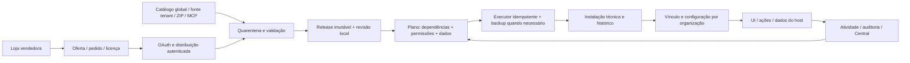

# Extensões — evolução compatível, loja, autoria assistida e distribuição entre instalações

- Data: 26/10/2026, America/Sao_Paulo.
- Estado: desenho de produto solicitado pelo usuário do fork; contratos técnicos propostos; não é uma ADR upstream aceita, nem anúncio de funcionalidade disponível.
- Base inspecionada: checkout WSL `/home/junio/projects/deskcommcrm-dev`, branch `master`, HEAD `f702a018ebc0d44b293fe6810e0db6f5563beaa5`, com alterações concorrentes não commitadas de Telegram/MCP. Arquivos descritos como existentes foram lidos nessa árvore; não se presume igualdade com a VPS ou com a main oficial atual.
- Público: implementador humano ou agente Luna, revisor de arquitetura, operador SaaS, desenvolvedor de extensão.
- Destino: **Ambos**. O núcleo oferece contratos genéricos de extensão, governança, dados e distribuição; os pacotes consumidores oferecem especializações. A operação comum deve continuar inteira com zero extensões.
- Companheiros obrigatórios: [contratos e banco](2026-10-26-extensoes-contratos-dados.md), [matriz de testes](2026-10-26-extensoes-matriz-testes.md), [plano executável](../plans/2026-10-26-extensoes-plano-execucao.md), [Mercado Pago separado](2026-10-26-mercado-pago-adaptador-design.md).

## 1. Convenção de evidência e precedência

**DECIDIDO PELO USUÁRIO** significa preferência de produto explicitada nesta conversa. **CONFIRMADO NA BASE** significa observado em arquivo/código/histórico identificado. **PROPOSTO** significa solução técnica recomendada para cumprir a preferência, ainda sujeita à revisão arquitetural e à prova. **POSTERGADO** significa capacidade prevista que não bloqueia o primeiro lançamento. Nada deste texto concede aprovação do mantenedor ou autoriza produção, publicação upstream ou acesso irrestrito a clientes.

A precedência vigente é `CLAUDE.md` > contratos em `docs/specs/` > PRDs > handoffs > README. Este desenho datado vive em `docs/superpowers/specs/` para não se fazer passar por contrato implementado. Antes de mudar uma decisão vigente, produzir uma ADR complementar/proposta, citando a regra revisada e suas consequências; não reescrever o histórico da ADR-0005 nem aumentar a capacidade de pacotes antigos silenciosamente. O usuário pediu respeitar fortemente visão e mentalidade do mantenedor, preservando a ambição funcional por caminhos aditivos.

## 2. Onde estão os documentos do projeto e das frentes anteriores

| Finalidade                                  | Local no repositório                                                                                                                                | Estado observado                                                                                                                           |
| ------------------------------------------- | --------------------------------------------------------------------------------------------------------------------------------------------------- | ------------------------------------------------------------------------------------------------------------------------------------------ |
| Contratos técnicos consolidados             | `docs/specs/`                                                                                                                                       | pasta oficial; índice em `docs/index.md`                                                                                                   |
| Decisões arquiteturais                      | `docs/adr/`                                                                                                                                         | ADRs 0002, 0003, 0004 e 0005 são referências obrigatórias                                                                                  |
| Desenhos datados                            | `docs/superpowers/specs/`                                                                                                                           | local deste desenho e do Telegram                                                                                                          |
| Passos de implementação                     | `docs/superpowers/plans/`                                                                                                                           | local do plano complementar                                                                                                                |
| Regras de negócio                           | `docs/business-rules/00-business-rules-catalog.md`                                                                                                  | atualizar somente quando o contrato correspondente existir                                                                                 |
| Mapas vivos                                 | `docs/architecture/*.architecture.json`                                                                                                             | fonte; HTML é derivado e nem todo mapa suporta render atual                                                                                |
| Casos humanos / WhatsApp                    | `docs/specs/15-spec-casos-humanos.md`, `docs/handoffs/HANDOFF-casos-humanos.md`, `docs/superpowers/plans/2026-07-23-casos-humanos.md`               | documentos existentes do domínio; não afirmar que todos foram criados pelo nosso patch                                                     |
| Nosso patch de responder caso pelo WhatsApp | commit `84852d545`, fragmento `.changes/whatsapp-resposta-caso-humano.md`, migration `20261016143000_0684_responder_caso_pelo_whatsapp_interno.sql` | o commit não acrescentou uma spec datada própria em `docs/`; contém implementação e testes. Merge upstream #3010 registrado em `e36bfc9e8` |
| Telegram original                           | `docs/superpowers/specs/2026-10-17-integracao-telegram-design.md`, mapa `docs/architecture/telegram-integracao.architecture.json`                   | o desenho está versionado no checkout WSL                                                                                                  |
| Telegram grupos/casos                       | `docs/superpowers/specs/2026-10-26-telegram-grupos-equipe-casos-design.md`                                                                          | arquivo preexistente não rastreado na árvore WSL consultada; preservar                                                                     |

O arquivo `docs/superpowers/plans/2026-10-17-telegram-primeira-fatia.md` existia na cópia Mac consultada antes, mas não existe no checkout WSL atual. Não copiá-lo como se já integrasse a branch compartilhada. Este diagnóstico resolve a diferença entre cópias sem alterar branches ou consolidar históricos.

## 3. Estado real e direção do mantenedor

### 3.1 O que já existe

`lib/extensions/manifest.ts` aceita `format_version: 1`, perfis `declarative` e `data`, `license: "MIT"`, `host_api` numérico, semver simples e `dependencies: []`. O parser é estrito, rejeita chaves desconhecidas e mede bytes/estrutura. O declarativo contribui guias/cartões, navegação com capacidades nomeadas e tema por tokens. Não executa JS, SQL ou CSS do autor.

O perfil `data` declara objetos com sete tipos e referências a contatos; o host compila tabelas e mostra fichas em painel do contato. O contrato `docs/specs/modulos-dados-declarados-v1.md` separa onda 1a entregue de 1b faltante: escrita, telas próprias, evolução completa e cobertura de privacidade ainda não estão entregues de ponta a ponta. A ausência destas capacidades não pode ser preenchida com SQL de pacote ou código privilegiado no Next.

Já existem `extension_catalogs`, `extension_artifacts`, `extension_installations`, `organization_extensions` e `extension_operations`; serviço, rotas e UI cuidam de admissão, instalar/atualizar, desfazer última troca, remover logicamente e configurar por organização. O histórico navegável atual é de um passo, não arbitrário. `lib/extensions/service.ts` lê os documentos imutáveis e verifica revisões/recibos. O banco valida novamente o contrato.

Uma instalação técnica hoje é compartilhada pela instância; a organização tem seu vínculo de uso/configuração. Instalar não autoriza efeitos e não ativa todas as empresas. `catalog_id + publisher + name` é identidade de instalação atual. Trocar catálogo não migra a instalação. As APIs mutantes atuais são de sessão/guard próprio; não supor que já aceitam bearer ou MCP.

O CRM já tem `lib/mcp/`, API tokens tenant-scoped e catálogo de tools, mas não foram encontradas tools de administração de extensões nem uma CLI pública para isso. O script `.agents/skills/deskcomm-extensao/scripts/validar-pacote.sh` é validador de desenvolvimento; não equivale à CLI operacional planejada.

A cobrança de empresas pelo dono da instalação já existe em `lib/cobranca/`, com `AdaptadorDeCobranca`, Stripe e Asaas, planos, assinaturas e régua. Não é o domínio de licenças e pedidos de extensões, nem um gateway genérico já pronto para toda venda de produto. Mercado Pago não foi encontrado implementado na base.

### 3.2 ADR-0005 e o que aprender com ela

A ADR-0005 foi criada pelo upstream em 02/10/2026 (`8f2552502`) e aceita em 14/10 (`a5cabe875`); não foi criada nesta conversa. Ela planeja quatro classes sob um contrato: `declarative`, `data`, `connected` (serviço do autor, interface isolada, eventos/tools nomeados) e `hosted` (Wasm local adiado). Híbrido significa composição de dados/UI do host com serviço autorizado; não é licença para executar código remoto dentro do processo privilegiado.

O fundamento continua válido: Next compila rotas em build; o app carrega credenciais privilegiadas; não há isolamento seguro de JS de terceiros dentro desse processo por simples flag; dezenas de contêineres não cabem na infraestrutura típica descrita pela ADR. Abrir pontos aditivos com consumidores reais cobre mais demanda com menor acoplamento que começar por hooks quentes genéricos.

### 3.3 Evidência nova: PR #3456 foi fechado sem merge

Consulta GitHub em 26/10/2026: PR #3456, head `60a99284d83478570096a1f0d2798f4829914894`, fechado em `2026-10-26T15:14:03Z`, `merged_at: null`. O mantenedor explicou que a proposta aceitava `turn_flow` sem nova permissão, usando ativação genérica como consentimento de envio e handoff. Solicitou capacidade/permissão nomeadas, aceite correspondente, provas de update/revert, pacote consumidor real e atividades de assumir/devolver; também apontou ramificações perdidas. A issue #3076 continuava aberta na consulta.

Consequência vinculante deste plano: não portar o PR como pronto nem generalizar ativação em permissão. O caso é referência negativa útil para a matriz de testes. Referências: <https://github.com/melgarafael/DeskcommCRM/pull/3456> e <https://github.com/melgarafael/DeskcommCRM/issues/3076>.

### 3.4 Quais decisões vigentes mudariam

| Tema                      | Contrato atual                                                 | Evolução solicitada                                                | Tratamento                                                                     |
| ------------------------- | -------------------------------------------------------------- | ------------------------------------------------------------------ | ------------------------------------------------------------------------------ |
| Atualização remota        | ADR-0005 D8: atualização nunca automática por origem           | auto-update local opcional com política do operador                | revisão explícita; servidor informa versão, scheduler local decide/aplica      |
| Comércio                  | D9: autor cobra fora do produto, host não intermedeia          | loja opcional no CRM vendedor, licenças e pedidos                  | domínio comercial opcional; preservar núcleo grátis e sem dependência de loja  |
| Licença                   | manifesto v1 MIT, nenhuma licença comercial validada pelo host | checagem opcional e direito de atualização                         | formato novo + políticas comerciais distintas de licença jurídica do código    |
| Instalação                | plataforma instala; org ativa                                  | tenant admin pode importar/instalar se política permitir           | delegação controlada; nenhuma escalada implícita para plataforma               |
| Distribuição              | JSON estrito, sem ZIP, dependências vazias                     | ZIP, fontes privadas, dependências versionadas                     | contrato v2 separado; parser v1 preservado                                     |
| Permissões em atualização | mudança é recusada                                             | continuar recusando no primeiro lançamento; fluxo explícito futuro | não mudar o conjunto concedido automaticamente                                 |
| Código local arbitrário   | não permitido no app/worker                                    | usuário quer autoria/publicação via MCP                            | MCP publica pacote suportado; executor `hosted` isolado é projeto posterior    |
| Versão por org            | recusada no contrato v1                                        | não foi decidida nesta conversa                                    | primeira versão continua única por instalação técnica; explicar impacto global |

## 4. Registro das decisões de produto da conversa

| ID  | Decisão ou limite                                                                                                         | Estado                                                                   |
| --- | ------------------------------------------------------------------------------------------------------------------------- | ------------------------------------------------------------------------ |
| D01 | Evoluir **Extensões**, preservando legado; nenhuma segunda arquitetura chamada Plugins                                    | decidido                                                                 |
| D02 | Inspirar-se em hooks, APIs comuns, descoberta e facilidade de instalar do WordPress                                       | decidido; compatibilidade binária com WordPress descartada               |
| D03 | Marketplace, operação e versões independem de Git                                                                         | decidido                                                                 |
| D04 | ZIP, importação por URL e autoria MCP convergem no mesmo pipeline de pacote                                               | decidido; implementação proposta abaixo                                  |
| D05 | Catálogo global de origem confiável configurável; loja interna do SaaS e fontes de tenants sob política                   | decidido                                                                 |
| D06 | Somente admin da organização gerencia suas extensões; superadmin pode atuar em contexto explícito de tenant ou plataforma | decidido                                                                 |
| D07 | Política de ZIP/desenvolvimento pode valer para toda a rede e empresas futuras, com exceções controladas                  | decidido                                                                 |
| D08 | Ocultar loja ou extensões disponíveis não remove funcionalidade já ativa nem oculta estado dos administradores            | proposta de semântica para evitar ambiguidade                            |
| D09 | Administração, leitura/edição autorizada e publicação via API/MCP; CLI desejável sobre mesma API                          | decidido para API/MCP; CLI proposta                                      |
| D10 | Janela temporária para publicação por MCP, confirmada no CRM e revogável                                                  | decidido como possibilidade; protocolo técnico proposto                  |
| D11 | Backups, histórico de versão, autoria de envio e recuperação são parte do ciclo                                           | decidido; limitações de rollback de dados explícitas                     |
| D12 | Gratuitas e pagas; modo operacional sem revelar fonte; autorizar desenvolvimento separadamente                            | decidido como política do produto; operador root não é contido por UI    |
| D13 | Licença opcional como checagem comercial; não tentar impedir remoção da trava pelo dono do servidor                       | decidido                                                                 |
| D14 | Um ano de atualizações e plano vitalício podem ser ofertas; duração configurável                                          | decidido como opções, sem impor um ano a todo vendedor                   |
| D15 | Base + complementos com dependências, versões e contrato entre extensões                                                  | decidido                                                                 |
| D16 | O próprio DeskcommCRM pode ser loja/vendedor e endpoint de licença/update para outro DeskcommCRM                          | decidido                                                                 |
| D17 | Conexão entre instalações com autorização de usuário, preferindo OAuth no navegador                                       | decidido como UX; protocolo detalhado proposto                           |
| D18 | Vendedor seleciona extensões autorizadas, cria oferta/produto e agentes vendem/explicam nos canais                        | decidido                                                                 |
| D19 | Venda manual e checkout configurado coexistem; manual pode lançar antes                                                   | decidido                                                                 |
| D20 | Autor, publicador, loja, vendedor, revendedor e comprador são papéis distintos                                            | decidido                                                                 |
| D21 | Autor permite ou não revenda e subrevenda, com termos e responsabilidades                                                 | decidido                                                                 |
| D22 | Comissão ou margem opcionais simples; registro/cálculo primeiro, repasse automático adiado                                | decidido                                                                 |
| D23 | Não prometer atestado inviolável de instalação self-host por desafio/hash                                                 | reconhecido; assinaturas provam procedência, não execução remota intacta |
| D24 | Adaptador Mercado Pago completo e UX de teste em frente independente                                                      | decidido; capacidades reais do provedor precisam de prova                |
| D25 | Leitura forte da visão do mantenedor e evolução aditiva, com cada conflito registrado                                     | decidido                                                                 |

## 5. Vocabulário e fronteiras

**Instância** é uma instalação física/lógica do DeskcommCRM. **Organização/tenant** é uma empresa dentro dela. **Fonte** é um emissor/catálogo confiável de metadados, não obrigatoriamente Git. **Pacote** é a unidade técnica. **Release** é uma publicação imutável de uma versão. **Artefato** são bytes identificados por digest. **Instalação técnica** é o registro compartilhado da versão desse pacote na instância. **Vínculo de organização** autoriza seu uso naquela empresa. **Oferta** combina pacote, preço, condições, prazo e vendedor. **Licença comercial** é o direito adquirido; **licença de código** rege direitos sobre o software. Nunca misturar esses dois significados em `license` v1.

**Autor** cria ou mantém, mas criação não prova titularidade comercial. **Titular de direitos** é quem autoriza distribuição; pode divergir do autor. **Publicador** assina/publica a release. **Loja** é o contexto comercial operado por uma organização. **Vendedor** fecha a venda e assume as responsabilidades anunciadas. **Revendedor** vende sob uma concessão; **subrevendedor** recebe uma concessão descendente autorizada. **Afiliado** apenas indica comprador; não recebe pacote nem poder de emitir licenças. **Comprador** pode ser contato externo e conta de portal; não ganha membership interno administrativo só para comprar.

Uma instalação pode comprar de várias lojas e também vender. Nenhuma conexão cria confiança transitiva ou acesso ao CRM remoto. A autorização comercial nunca concede permissões do CRM.

## 6. Arquitetura funcional única

Tela, API, MCP e CLI chamam o mesmo serviço de aplicação. O serviço produz um plano, valida autoridade e aplica via RPCs transacionais. Nenhuma superfície escreve o ponteiro de versão por fora. Separar metadados públicos, gestão administrativa, conteúdo de desenvolvimento e segredos por projeções diferentes.

Uma fonte informa versão nova; não comanda atualização nem desliga extensões remotamente. A política local revalida assinatura, compatibilidade, dependências, direitos, permissões, prazo e backup. A instância compradora não é agente subordinado à loja.

## 7. Escopos e políticas de rede

### 7.1 Política efetiva

Definir, sem booleano único que misture tudo: ver loja, instalar de catálogo aprovado, importar ZIP, propor fonte própria, criar rascunho, ler fonte, editar, publicar, atualizar automaticamente, exportar e excluir dados. Política de instalação é teto; política da organização pode restringir. Superadmin pode configurar defaults para atuais e futuras empresas ou uma exceção expressa por empresa; o tenant não aumenta o teto. Defaults herdados são resolvidos em leitura e execução, sem copiar flags para toda empresa.

O significado de “todas atuais e futuras” é herança de permissão, não autoexecução de pacotes. Operações em massa enumeram alvos e registram resultados por empresa. Habilitar um pacote na rede significa **disponibilizá-lo** às empresas elegíveis. Respeitar a recusa/desativação da empresa; não reativar o vínculo contra sua decisão. Para ativação inicial em lote, exigir consentimento delegado explícito e interromper para as empresas que recusaram. Este limite preserva a direção da doutrina vigente.

### 7.2 Matriz de autoridade

| Operação                                       | viewer/agent/manager        | admin tenant                                           | superadmin                                                                                        |
| ---------------------------------------------- | --------------------------- | ------------------------------------------------------ | ------------------------------------------------------------------------------------------------- |
| Usar recurso ativo                             | conforme RBAC de dados/ação | sim                                                    | somente em contexto autorizado                                                                    |
| Ver gestão da própria org                      | leitura segura se permitido | sim                                                    | contexto tenant ou visão de rede                                                                  |
| Configurar/ativar/desativar vínculo próprio    | não                         | sim, se política/licença/grants permitirem             | sim, auditado; consentimento não é simulado                                                       |
| Instalar pacote aprovado para sua org          | não                         | se delegado pela plataforma                            | sim                                                                                               |
| Enviar ZIP ou criar/editar extensão própria    | não                         | apenas com política específica e direitos              | sim, com política de autoria                                                                      |
| Atualizar pacote compartilhado por outras orgs | não                         | propor; não trocar versão de terceiros                 | plano global explícito                                                                            |
| Revogar/fixar origem de confiança              | não                         | só sua conexão sob teto global                         | sim                                                                                               |
| Publicar para venda                            | não                         | loja própria autorizada + direitos de distribuição     | governança da plataforma, sem se apropriar de autoria                                             |
| Ler dados internos de outra org                | não                         | não                                                    | fluxo separado de suporte, consentimento e auditoria; ser admin da rede não expõe tudo nesta tela |
| Executar publicação via MCP                    | não                         | papel + scope + grant temporário + artefato autorizado | grant de plataforma próprio, não token tenant promovido                                           |

Tenant “desinstala” desvinculando sua empresa e preservando dados/configuração. Remover a instalação compartilhada é ato de plataforma. Limpeza física de dados é uma ação distinta e não está no botão comum de desinstalar.

### 7.3 Fontes próprias

O admin informa URL de catálogo ou provedor. A plataforma valida HTTPS, destinos, protocolo, identidade e política; mostra quem é publicador, quem revisou e se é fonte verificada ou privada não verificada. Fonte tenant fica visível só naquela empresa até promoção explicitamente revisada. Não aceitar URL como certificado de autoria. Mesmo nome em outra fonte é outra identidade; nenhuma atualização troca de publicador/origem silenciosamente.

## 8. Autoria, pacote e experiência de desenvolvimento

### 8.1 Sem Git obrigatório

O usuário pode pedir ao MCP “leia minha extensão de comissão, acrescente campo e gere versão candidata”. O sistema confere direitos de desenvolvimento, exporta todos os arquivos permitidos com listagem e paginação, abre workspace isolado, valida alterações e produz release candidata. Ler completamente significa um inventário verificável com digests e ferramenta de leitura por arquivo; não significa devolver ZIP inteiro em texto até estourar o contexto do agente.

MCP pode concluir com download autorizado de ZIP, ou publicar/instalar via plano confirmado e grant temporário. O agente não recebe chaves de banco nem shell do app. Código/publicação significa pacote em perfil suportado; não habilita executar JS dentro do Next. Um executor local arbitrário requer projeto `hosted` separado, não é desbloqueado pelo grant de duas horas.

Git é integração avançada opcional; fork/clone/push somente com conta e autorização específica. Receber ZIP nunca cria Git oculto nem exige login GitHub. Publicar versão é ato interno do CRM e não depende de commit/tag. Se houver commit, armazenar como referência opcional, sem chamá-lo de prova de confiança.

### 8.2 Proteção operacional de pacote comercial

Padrão de pacote pago: operar/configurar sem exportar fonte, baixar bytes internos, editar ou publicar cópia pela UI/API/MCP. Superadmin controla se admins podem desenvolver inclusive pacotes gratuitos. Uma extensão gratuita não é automaticamente editável; uma extensão paga não precisa ser fechada se o titular autorizar explicitamente. Direitos efetivos = política global ∩ política tenant ∩ direitos concedidos ∩ papel/escopos atuais.

Os autores/titulares autorizados conseguem exportar seus próprios pacotes. Uma credencial de licenciamento não libera fonte; endpoint de atualização entrega bytes apenas ao host autorizado. Operador root de self-host pode inspecionar/modificar o que está no seu servidor; isto foi aceito pelo usuário. Não prometer DRM, criptografia mágica ou bloqueio inviolável.

### 8.3 ZIP e release

Primeiro ZIP é contêiner de manifesto/declarações/documentação/assets permitidos. Não aceitar dependências npm, `package.json` com hooks, scripts de instalação, SQL, executáveis ou rotas Next copiadas do terceiro. Sem `eval`, imports dinâmicos do pacote, descompactação dentro de `app/` ou escrita na árvore do CRM. O ZIP passa por limites de bytes expandidos, quantidade/profundidade, caminhos normalizados, symlinks, colisão de nomes e inventário. Hash do ZIP identifica o transporte; hash/inventário dos conteúdos identifica o conteúdo revisado.

Mesma identidade + versão + bytes diferentes é conflito; correção exige nova versão. Pacote instalado original permanece imutável; edição abre rascunho derivado com autoria/proveniência própria. Declaração de publicador no manifesto não prova posse do namespace.

### 8.4 SDK e exemplos

Entregar JSON Schema versionado e validador que reutiliza o parser do host, gerador de pacote, exemplos executáveis e laboratório sem dados reais. Primeiro consumidor real: extensão privada “Qualificação de uniformes” (quantidade, modalidade, prazo desejado) em ficha de contato/lead, com cartão e ação de criar tarefa; complemento “Comissão de uniformes” demonstra dependência e registros próprios. São exemplos sintéticos, não exigência de negócio imposta a todos.

Outro exemplo é loja de extensão gratuita com licença manual opcional para provar distribuição entre duas instalações. Cada ponto de extensão entra junto de pelo menos um pacote consumidor, teste do host e jornada do pacote. Não anunciar SDK antes de existir esse ciclo.

## 9. Extensibilidade por superfície

| Ordem     | Superfície                       | Contrato proposto                                | Consumidor e benefício              | Guarda                                                                               |
| --------- | -------------------------------- | ------------------------------------------------ | ----------------------------------- | ------------------------------------------------------------------------------------ |
| 1         | Campos em contato e lead         | definição tipada, namespace, validação e vínculo | qualificação específica sem fork    | reusar `crm_leads.custom_fields`/schema de pipeline onde couber; sem duplicar coluna |
| 1         | Seções de ficha e cartões        | slots estáveis + blocos host-rendered            | dados/contexto próximos da operação | sem HTML/JS/CSS livre; RBAC em cada leitura                                          |
| 2         | Objetos e formulários de domínio | ampliar perfil `data` e compilador               | contratos, parcelas, comissões      | FK composta tenant, CRUD do host, LGPD antes de dados pessoais                       |
| 2         | Ações contextuais                | nome + input/output + efeitos + grants           | criar tarefa/proposta/retorno       | mesma regra de domínio e audit da ação nativa                                        |
| 3         | Eventos e integrações            | eventos versionados + entrega assinada           | sistemas externos e sincronização   | outbox, dedup, retry, DLQ, revogação                                                 |
| 3         | Agentes/automação                | registro genérico de ferramentas/ações           | executar domínio da extensão        | ferramentas administrativas indisponíveis ao agente comercial                        |
| 4         | Dashboards e relatórios          | métricas agregadas tipadas                       | acompanhar operação do módulo       | sem SQL livre do autor e sem cross-tenant                                            |
| 4         | Telas próprias conectadas        | iframe separado + RPC estreito                   | serviços de autor com lógica remota | CSP/sandbox, sem cookies ambientados, origem validada                                |
| posterior | Fluxos antes da IA               | capacidade e permissão específicas               | caso real da issue #3076            | revisão separada, todos silenciadores, emissão pela cadeia, anti-loop                |
| posterior | Lógica local customizada         | runtime isolado `hosted`                         | casos que declaração não cobre      | ADR, limites CPU/memória/tempo, rede/FS/DB mediados; não implementar no lote inicial |

Campos precisam aparecer em edição, filtros, export, API/MCP, importação e visões relevantes, ou declarar escopo menor na entrega. Não copiar modelo universal de posts do WordPress para dinheiro, mensagens ou identidades. Metadados são úteis, mas precisam de tipo, dono, validação e ciclo de vida. Extensões base podem registrar objetos/capacidades para complementos com contratos versionados e referências explícitas.

## 10. Dependências e famílias de extensões

É um DAG, não árvore: “Comissão” e “Relatórios” podem depender da mesma base. O catálogo apresenta famílias, mas a resolução usa nós `(source, publisher, package, version)` e arestas obrigatórias/opcionais. Intervalos semver são de contrato; prerelease só com canal escolhido. Não escolher “latest” em produção sem resolver versão/digest e guardar lockfile do plano.

Uma dependência instalada não equivale a ativa. Ativar complemento exige base ativa na mesma organização e grants próprios. Biblioteca técnica sem UI pode ter papel declarado de dependência; não ganhar acesso aos dados só por carregar junto. Desativar base com dependentes mostra impacto e oferece desligar o conjunto; nenhuma remoção em cascata silenciosa de dados. Ciclos e conflitos resultam em explicação dos caminhos envolvidos, antes de qualquer efeito.

A primeira entrega conserva uma versão técnica por instalação de pacote. Atualizar uma base compartilhada é operação de rede e precisa satisfazer todos os dependentes instalados; admins tenant não trocam código de outras empresas. Solicitação tenant de outra versão vira proposta ao superadmin. Se futura necessidade exigir versões simultâneas por tenant, registrar ADR e evolução de schema/runtime; não improvisar com ponteiros por org sobre a mesma tabela de dados.

## 11. Operações, versão e recuperação

Toda mutação tem recibo durável idempotente, fingerprint de conteúdo, ator, origem, escopo, revisões e resultado. Há distinção entre falha conhecida e resultado desconhecido. Se perdeu resposta, consultar recibo em vez de repetir efeito. Plano fixa digests, dependências, política, consentimento e revisões; alterações invalidam plano ou exigem replanejar.

Antes de troca com alteração de dados: verificar capacidade e espaço, criar backup/snapshot apropriado pelo host, registrar evidência e testar restaurabilidade no ambiente de ensaio. Backup de instância inclui banco, Storage/artefatos e configurações necessárias; nunca expor dump global a um tenant. Uma alteração declarativa de texto sem mutação de dados preserva artefato/configuração anteriores, sem prometer pg_dump completo por clique. É o risco real da operação que define a política de backup.

Histórico permite selecionar versão anterior compatível. Rollback do pacote altera ponteiro e invalida caches após commit. Rollback de schema/dados é outra pergunta: migrations expand-and-contract, leitor antigo compatível, schema_version mínima/máxima, e bloqueio explícito se incompatível. Restauração integral de um banco compartilhado pode apagar operações de outras empresas desde o backup: não é rollback automático de uma única extensão. Para transformação irreversível, exigir plano de manutenção/restauração coordenado ou correção por avanço.

Falha de instalação conserva versão atual, abertura de incidente e ação de retomar/cancelar. Downloads e cópias de Storage ficam fora da transação SQL; publicação só após artefato completo verificado. Não manter lock do banco enquanto faz rede/backup. Um fencing token impede worker vencido concluir depois de outro. Coordenação com atualização do core preserva a trava vigente e explicita limite de operações manuais externas.

## 12. Licenças e atualizações

Licenciamento é opcional por produto e por fonte; pacote gratuito/offline continua sem consultar servidor. Ofertas podem conceder uso perpétuo com atualizações por 12 meses, prazo customizado, atualizações vitalícias, ou assinatura de uso quando explicitamente anunciada. `use_expires_at`, `updates_expires_at` e prazo de suporte são direitos separados; `null` significa sem término, nunca vencimento desconhecido.

Padrão proposto para oferta de uso perpétuo com atualizações anuais: expirou atualizações, conserva funcionamento e versões já autorizadas; não recebe releases posteriores ao corte. Renovação/reembolso/revogação seguem termos da oferta e autorização local. Loja indisponível não é licença inválida: exibir última validação e usar concessão assinada/cache no período previsto. Não desativar automaticamente o CRM ou apagar dados por falha de internet. Política exata de grace period e assinatura de uso deve ser decidida por oferta e comunicada; nenhum número é SLA presumido.

A validação devolve documento de direitos assinado, vinculado a issuer, produto, licença, instalação/organização quando aplicável, audience, versão do protocolo e validade; nunca um booleano transportado sem contexto. Armazenar token de acesso externo cifrado; na loja, guardar hash do segredo de ativação, mostrar uma vez, permitir rotação/revogação. Não mandar token em URL nem log.

Auto-update é **opção local**, desligada no primeiro rollout e opt-in posterior por fonte/pacote/canal/faixa/janela. Mesmas validações da instalação manual; não aumentar permissões; manter pacote recuperável e receber aviso com resultado. Expiração de licença não baixa um pacote inferior nem troca o publicador. Vulnerabilidade urgente pode gerar recomendação e alerta; execução automática segue política previamente autorizada, não comando soberano remoto.

## 13. Loja no próprio DeskcommCRM

### 13.1 Vendedor e comprador

O operador da instância habilita o recurso opcional de venda de extensões e permite quais organizações podem ter loja. A loja pertence a uma organização vendedora; seus produtos, pedidos, compradores e recebimentos não são tabelas globais sem tenant. O superadmin pode ter sua empresa como loja, mas o modelo serve igualmente a uma organização autorizada. Habilitar uma loja nunca publica todas as extensões instaladas.

Selecionar pacote instalado/possuído é conveniência de UI; publicar venda exige direitos de distribuição e procedência. Autor não se torna automaticamente titular se trabalhou para outra pessoa; compra operacional não concede revenda. A oferta fixa pacote/release/canal, preço em centavos/moeda, condições, prazo, suporte, política de atualizações e licença de redistribuição. Criação de nova oferta não reescreve os direitos de pedidos antigos.

Página externa simples respeita marca da loja, informações do vendedor, preço, condições e compra/login. Conta compradora é conta de cliente/portal vinculada ao contato, ou autorização equivalente; nunca `admin`/membership gratuito no CRM vendedor. Compra manual pode ser feita sem portal no primeiro incremento; ativação/entrega segue código de resgate ou vínculo autenticado.

### 13.2 Produtos e agentes

Oferta de extensão referencia produto no catálogo comercial existente (`catalog_products` e handlers de `app/api/v1/products/`), sem duplicar preço como fonte concorrente. Se a estrutura atual não atende variantes de licença, criar referência 1:1 e campos/projeção comercial, preservando preços imutáveis do pedido. Auditar sincronização e resolver conflitos; importação externa de produtos não altera termos de extensão por acidente.

Preparar conhecimento revisado por oferta/release: descrição, requisitos, compatibilidade, instalação, política de licença, limites, changelog, FAQ, suporte e exemplos. Agentes consultam preço/condições ao vivo e material autorizado; não ler ZIP indiscriminadamente nem obedecer instruções de manifesto como system prompt. Ferramentas comerciais podem cotar/criar checkout/consultar pedido; não podem instalar pacote no CRM comprador, conceder revenda, editar preço ou marcar pagamento manualmente. Venda em todos canais passa pelas capacidades e guardrails existentes.

### 13.3 Pagamentos

Dois caminhos obrigatórios: venda externa confirmada manualmente por vendedor autorizado, ou checkout no gateway configurado. Confirmação manual tem ator, justificativa e referência não sensível; idempotência evita duas licenças. Webhook do gateway só acorda releitura confiável; valor, moeda, vendedor/conta, pedido e ambiente precisam conferir. Redirect do navegador, print ou declaração do comprador não marcam pago.

Primeiro lançamento comercial aceita registro manual. Checkout automatizado é etapa posterior do mesmo desenho. A cobrança de tenants (`cobranca_planos`, `cobranca_assinaturas`) permanece no seu domínio; reutilizar transporte/credenciais/contratos apenas quando a semântica couber. O contrato atual é voltado a assinatura, então venda avulsa de extensão requer contrato próprio de pedido/pagamento, sem forçar `assinaturaRef` fictícia.

### 13.4 Revenda e comissão

O titular define concessões. Cada concessão tem concessor, beneficiário, produto, parent_grant, validade, direitos, limite de profundidade e revisão dos termos. Filho não concede mais direitos nem validade maior que o pai. Comprar para usar não cria concessão. Registro de cadeia é rastreabilidade; não é rede de remuneração por recrutamento.

Começar com revenda direta e possibilidade de subrevenda explicitamente habilitada, profundidade limitada por política proposta. Revogação bloqueia novas vendas descendentes; destinos de licenças já vendidas seguem os termos vigentes no pedido, sem desligamento em cadeia presumido. Preservar titular/publicador original e vendedor comercial. Atualizações oficiais mantêm identidade e assinatura de origem mesmo quando entregues por revendedor. O controle de revenda aqui trata da autorização comercial, das licenças e do canal oficial; não deve retirar direitos já concedidos pela licença do código. Pacotes MIT legados continuam MIT: cobrar, ocultar a fonte na interface ou exigir token de updates não transforma seus direitos jurídicos retroativamente.

Comissão/margem opcionais simples: comissão fixa em centavos OU percentual em pontos-base sobre base explicitada (ex.: valor efetivamente recebido após descontos; impostos/taxas precisam de decisão documentada); margem = revenda menos custo contratado, não se soma automaticamente à comissão. Regra fica congelada no pedido. Cada venda gera cálculo/lançamento a pagar; liquidação manual com comprovante de referência e audit. Reembolso estorna a parcela proporcional segundo política. Split, saques, saldo financeiro disponível e repasse automático são projetos posteriores; não exibir cálculo como dinheiro já pago.

## 14. Conexão entre instalações

Instância compradora informa URL da loja; descoberta autenticável informa issuer e protocolo. No browser, OAuth Authorization Code com PKCE S256, state, redirect URI previamente permitido e validação de issuer. Device Flow opcional para CLI/MCP sem browser/callback, não substitui fluxo web desnecessariamente. Evitar implementar criptografia/OAuth do zero: avaliar biblioteca mantida contra os contratos reais.

A pessoa faz login no **vendedor**, escolhe conta/loja e compra a vincular, vê instância/empresa compradora e aprova escopos. Não precisa ter mesmo e-mail, senha ou ID nas duas instalações. Tokens delegados não incluem acesso a contatos/conversas do comprador; escopos iniciais: catálogo, direitos, versões e download autorizado. Login OAuth não concede confiança ao publicador nem instala pacote automaticamente.

URLs de descoberta e token passam por validação de HTTPS, DNS/IP pinado, proteção SSRF e mix-up; callbacks validam state/issuer/client e código de uso único. Segredos em banco cifrado do cliente; refresh rotativo; desconectar revoga acesso a novas consultas/downloads, preserva pacotes/dados locais e mostra efeito na tela. Uma falha da loja gera estado observável e próximo passo, não sessão global quebrada do CRM.

## 15. Integridade e confiança

Hash compara conteúdo; assinatura vincula artefato ao publicador; catálogo autoriza a versão; curadoria registra revisão. Essas garantias são distintas. Uma instalação administrada por terceiro pode responder hashes falsos ou usar cópia limpa para responder desafio enquanto executa outra. Challenge-response que só mistura nonce com hash recebido não atesta execução real. Não implementar “fiscal inviolável” com leitura de arquivos controlada pelo fiscalizado.

Podem existir selo de release oficial verificada, histórico de revisões, SBOM/proveniência, status de suporte e diagnóstico autodeclarado. Atestado de execução com raiz externa (hardware/infraestrutura confiável) é capacidade diferente, complexa e fora do primeiro escopo. Loja não deve exigir atestado impossível para funcionar em self-host. Assinatura de pacote não atesta ausência de vulnerabilidades.

## 16. Privacidade, confiabilidade e operação

Cada contribuição declara dados lidos/escritos, finalidade, sensibilidade e retenção. Dados pessoais só entram quando export/redact/delete e referências de contato forem provados. Campos sensíveis não saem para `connected` sem contrato e consentimento específico; contratos vigentes podem proibir totalmente, e o plano deve respeitá-los. Nenhuma telemetria de adoção é ligada implicitamente por licença. A consulta comercial transmite só identificadores necessários e declarados.

Auditoria mostra ator humano originador, principal executor/token, organização, fonte, pacote, versões e recibo, sem chave, código, conteúdo de cliente ou dump. Clientes têm atividade visível e Central de avisos em falhas de instalação/update/licença; um erro chega a uma pessoa responsável com “tentar novamente”, “reautorizar”, “replanejar”, “cancelar” ou “ver histórico”. Cron vazio não gera avalanche de audit.

Artefatos ficam em bucket privado próprio, não em `whatsapp-media`; política de retenção preserva ativo, versão anterior recuperável e versões referenciadas por pedidos/provas. GC é por referências e operação concluída, nunca por idade isolada. Tamanho/disco e execução são limitados por política documentada e medidos antes de escala; não inventar teto de extensões ou SLA a partir de uma VPS de exemplo.

## 17. Compatibilidade, rollout e critérios de conclusão

- Contrato v1 continua aceitando exatamente o que aceitava; campos v2 desconhecidos continuam recusados no v1.
- Nenhuma mudança no manifesto v1 para aceitar `license` comercial ou dependências não vazias por relaxamento silencioso.
- Backfill de fonte/release mantém IDs, artefatos, configurações, revisões, removidos e recibos originais.
- Pacote de versão velha e erro desconhecido não derrubam toda a lista; estado visível e recuperação existentes são preservados.
- Novas lojas/licenças/autoria nascem desligadas, sem novas variáveis obrigatórias e sem dependência de internet para o núcleo.
- JSON antigo, admissão manual e operações atuais continuam funcionando durante rollout; ZIP é adição de transporte.
- Matriz de testes inclui instalações frescas, upgrade com dados, reapply do baseline, duas orgs, falhas/retries, evidência visual e provas em par de IA.
- Não há rollout para VPS nem PR upstream implícitos nesta escrita. Cada entrega implementada precisa fragmento de release, mapa e DoD aplicável.

## 18. Referências obrigatórias, com propósito

### Fontes do repositório (ler novamente no início da execução)

1. `CLAUDE.md`, `AGENTS.md`, `VISION.md`, `ARCHITECTURE.md`, `docs/index.md`: doutrina, posicionamento, precedência, self-host.
2. `docs/doctrine/extensoes.md`; `docs/specs/extensoes-declarativas-v1.md`; `docs/specs/modulos-dados-declarados-v1.md`: ciclo atual e limites reais.
3. `docs/adr/0002-tabelas-de-modulo-num-banco-so.md`; `0003-perfil-declarativo-v2-portas-nomeadas-e-vitrine.md`; `0004-cobranca-do-revendedor.md`; `0005-plataforma-de-modulos-de-terceiro.md`: separar módulo nativo, contrato declarativo, assinatura SaaS e distribuição de terceiro.
4. `docs/research/extensoes/01-o-que-impacta.md` a `10-integracao-riscos.md`; `docs/research/modulos/pagamentos-e-fiscal.md`: evidências, alternativas e riscos; pesquisa não é implementação.
5. `docs/doctrine/sistema-vivo.md`, `docs/doctrine/prova-em-par.md`, `docs/doctrine/packaging.md`, `docs/doctrine/versionamento.md`, `docs/testing/user-journey-map.md`: observabilidade, aceites e distribuição.
6. `lib/extensions/`, `lib/modulos/`, `components/extensions/`, `components/modulos/`, `app/api/v1/extensions/`: fonte executável dos contratos.
7. `lib/mcp/`, `lib/api/auth-dual.ts`, `lib/auth/public-paths.ts`, `lib/auth/require-role.ts`, `lib/impersonate/support.ts`, `lib/audit/`: identidade, autoridade, superfícies e audit.
8. `lib/cobranca/provedores/contrato.ts`, `lib/cobranca/provedores/{stripe,asaas}.ts`, `docs/saas/cobranca.md`: adaptar o que existe sem inventar gateway universal já entregue.
9. `supabase/migrations/20260917120000_0271_extensoes_declarativas.sql`, `20260918011500_0282_extensoes_perfil_v2.sql`, `20261008130000_0611_modulo_de_dados_compilador.sql`, e ÚLTIMAS definições do baseline: não medir função antiga do dump.
10. `tests/invariants/extensoes-declarativas.test.ts`, `modulo-de-dados-compilador.test.ts`, `tests/e2e/extensoes-*.spec.ts`, `vitest.config.ts`, `vitest.cercas.ts`, workflows CI/e2e/perf: regressão e gates.
11. `.agents/skills/deskcomm-extensao/SKILL.md`, `deskcomm-doutrina/SKILL.md`, `sistema-vivo/SKILL.md`: regras operacionais; onde a skill desatualizada contradiz contrato implementado, registrar e atualizar na entrega, sem confundi-la com evidência de inexistência.

### Fontes externas primárias

- WordPress Hooks: <https://developer.wordpress.org/plugins/hooks/> — inspiração em ações/filtros; não copiar acesso privilegiado irrestrito.
- Instalação WordPress: <https://wordpress.org/documentation/article/manage-plugins/> — UX de diretório e upload.
- Dependências WordPress: <https://developer.wordpress.org/reference/classes/wp_plugin_dependencies/> — ciclos/dependentes; não supor resolução completa de ranges.
- Shopify extensões: <https://shopify.dev/docs/apps/build/app-extensions> — superfícies contratuais.
- Atlassian Forge módulos: <https://developer.atlassian.com/platform/forge/manifest-reference/modules/> — contribuições declaradas.
- OAuth Security BCP RFC 9700: <https://www.rfc-editor.org/info/rfc9700/> — PKCE, redirect e proteção de autorização; consultado em 26/10/2026.
- Device Flow RFC 8628: <https://www.rfc-editor.org/info/rfc8628/> — autorização de CLI/dispositivo; não é prova de instalação íntegra.
- Sigstore: <https://docs.sigstore.dev/cosign/verifying/verify/> — identidade/digest e procedência.
- TUF: <https://theupdateframework.github.io/specification/latest/> — modelo para metadados, validade, rollback e rotação; avaliar implementação mantida antes de criar protocolo criptográfico próprio.
- PR upstream #3456 e issue #3076, acima: posição recente e concreta do mantenedor, não promessa de merge.
- Documentação Mercado Pago referenciada no anexo específico: verificar novamente capacidades por produto antes de implementar.
